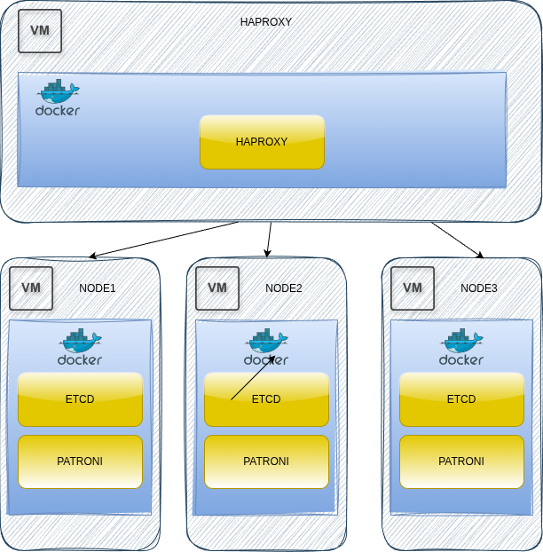

# pgsql-ha-patroni-3nodes

PostgreSQL high availability on **four separate VMs**: three database nodes, each running an **etcd** member and **Patroni + PostgreSQL 16** in Docker, plus one VM with **HAProxy** in front. Multi-host version of [`../pgsql-ha-patroni`](../pgsql-ha-patroni).



| VM | IP (as configured) | Directory | Containers | Published ports |
|---|---|---|---|---|
| HAProxy | any | `haproxy/` | `haproxy` | `5432` write, `5433` read, `7000` stats |
| Node 1 | `10.183.116.182` | `node1/` | `etcd1`, `pg-node1` (Patroni `patroni-1`) | `2379`, `2380`, `5432`, `8008` |
| Node 2 | `10.183.116.225` | `node2/` | `etcd2`, `pg-node2` (Patroni `patroni-2`) | `2379`, `2380`, `5432`, `8008` |
| Node 3 | `10.183.116.92` | `node3/` | `etcd3`, `pg-node3` (Patroni `patroni-3`) | `2379`, `2380`, `5432`, `8008` |

- **etcd** – 3-member cluster (one per node), stores the Patroni leader lock; tolerates the loss of one node.
- **Patroni** – manages PostgreSQL, elects the primary through etcd, streams replication to the others, exposes a REST API on `8008`.
- **HAProxy** – checks every node's Patroni API: `GET /primary` → port `5432` (writes), `GET /replica` → port `5433` (reads).

## Deployment

1. **Adjust IP addresses** to your VMs in `node*/docker-compose.yaml` (etcd URLs, `PATRONI_*_CONNECT_ADDRESS`), `node*/patroni.yml` (`etcd3.hosts`) and `haproxy/haproxy.cfg` (`server` lines).
2. Copy each `nodeN/` directory to its VM and start it – all three within a short time, so etcd can form the cluster:

   ```bash
   cd node1 && docker compose up -d --build      # on VM 1, same for node2 / node3
   ```

3. On the HAProxy VM:

   ```bash
   cd haproxy && docker compose up -d
   ```

4. Check the cluster from any node:

   ```bash
   docker exec pg-node1 patronictl -c /etc/patroni/patroni.yml list
   docker exec etcd1 etcdctl member list
   ```

Clients connect to the HAProxy VM: `psql -h <haproxy-ip> -p 5432 -U postgres` (read-write) or `-p 5433` (read-only). HAProxy stats: `http://<haproxy-ip>:7000` (login `admin` / `pass`).

Failover test: stop the leader's container (`docker stop pg-node1` on its VM) and watch another node take over in `patronictl list` and on the HAProxy stats page.

## Files

| File | Purpose |
|---|---|
| `nodeN/Dockerfile` | `postgres:16-alpine` + Python + `patroni[etcd3]`; sets `PYTHONMULTIPROCESSING_START_METHOD=fork` for Python 3.14+ |
| `nodeN/docker-compose.yaml` | etcd member + Patroni node with published ports and `pgdata` volume |
| `nodeN/patroni.yml` | Patroni config (3 etcd hosts, replication, `pg_hba`, users); TCP only (`unix_socket_directories: ''`) |
| `haproxy/docker-compose.yaml`, `haproxy/haproxy.cfg` | HAProxy with health checks against the three Patroni APIs |
| `patroni-3nodes.png` | architecture diagram |

## Notes

- All three etcd members use `--initial-cluster-state=new`, which is right for bootstrapping a fresh cluster. When adding a node to an already running etcd cluster, register it first with `etcdctl member add` and start it with `--initial-cluster-state=existing`. The flag is ignored once a member has its data directory.
- Passwords (`SuperPassword123`, `ReplicaPassword123`, HAProxy `admin:pass`) are in the repository and `pg_hba` allows `0.0.0.0/0`; etcd and Patroni APIs are published without TLS or authentication – use only in an isolated network.
- HAProxy itself is a single point of failure; production setups add a second HAProxy with a virtual IP (keepalived).
